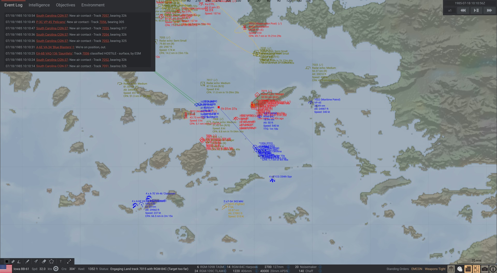
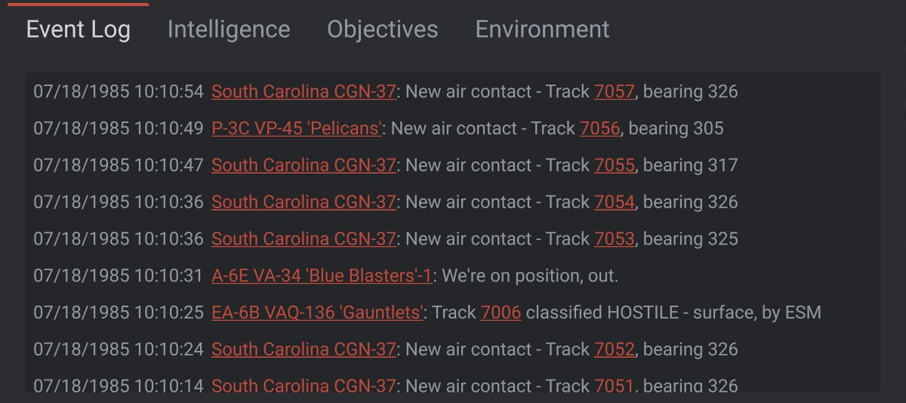
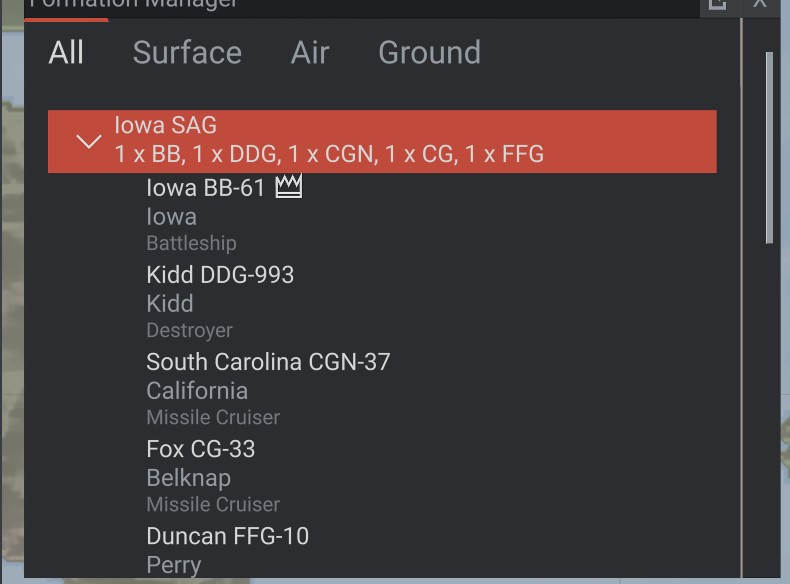

# Sea Power Radio

A mod for [Sea Power: Naval Combat in the Missile Age](https://store.steampowered.com/app/1286220/) that makes the
radio net sound like people instead of a screen reader, and makes units tell you **why** they are not doing what you
ordered.

**[Get it on the Steam Workshop](https://steamcommunity.com/sharedfiles/filedetails/?id=3826433579)** – requires
[Anchor Chain](https://steamcommunity.com/sharedfiles/filedetails/?id=3380210757).

**[Watch and listen on YouTube](https://youtu.be/pGwOIPXckpY)** (1:49, sound on) – the same call before and after
1.0.1, then the radio net while Yak-38s close in on the Iowa group. The 1.0.0 video: https://youtu.be/g7P1pg2J0Lk.



- **Per-element voices** – 43 distinct people (American, Canadian, English, Scottish, Irish, Northern Irish,
  Australian and New Zealand accents, men and women). Every player unit, and every aircraft a carrier or airbase can
  launch, gets its own voice the moment it exists. Deterministic per mission, so a reload keeps the same voices.
- **Callsigns** – ships and shore units say their in-game short name ("Iowa", "Pargo"), aircraft their squadron
  callsign from the game ("Lancer 3-2"), everyone else a generated NATO callsign ("Viper two-one", "Sentinel").
  Every clip is cut from a whole spoken sentence, so callsign, phrase, bearings, track numbers, altitudes and counts
  join like one person talking – without a pause before a number ("bearing two seven three") unless the sentence
  has one ("track 7034, faded").
- **Stock voices replaced** – the game's voice lines are muted and re-spoken by the unit that actually said them.
  Speed and altitude orders say which way they go and where to ("coming up to two thirds", "descending, angels
  five"; a speed set in knots too), launch calls name the weapon that is actually leaving ("harpoon
  away", "anti-ship away", "missile away", "torpedo away"). Voice lines of other mods play as before.
- **Brevity on the net** – a unit only says its name when it takes over the net from someone else; the same
  unit again just goes on, a wingman of the same flight gives its number only ("two, fox three").
- **A real net** – urgent calls (missile inbound, we're hit, bingo) cut in, replies to your
  orders go before routine reports and are mixed louder and cleaner, stale calls are dropped (a late "copy" is worse
  than none), the same phrase from a whole flight is said at most twice. Radio sound per transmission: carrier hiss,
  mic click, crackle, squelch tail; plays through the game's voice channel, so its volume slider applies.
- **Overlapping voices** (on by default) – like a busy net, several stations can talk over each other: a new call
  starts a second or so after the last one began, while it is still playing (up to 3 at once, panned a little left and
  right, never the same unit twice at once). Off: one voice at a time, the rest wait in the queue.
- **Settings in the Options menu** – Options > Audio has a group **Rats Radio**: female voices on/off, overlapping
  voices on/off, radio volume, radio static (0 = clean voice, 100 % = the default amount) and a volume for each kind
  of call: contact and track calls, combat calls, warning calls (inbound missile, we're hit, bingo...), replies to
  orders, other calls - for example to make "new contact" and "track identified" stand out. Changes apply at once and
  are saved in the config file.
- **Female voices** – the voice library has male and female voices; switch the female ones off and units speak with
  male voices only (a unit whose name was rendered only in a female voice keeps it).
- **Why-not diagnostics** – the reasons the game knows but never says, spoken by the unit, as a message and in
  the log: not in rear aspect, outside the launch envelope, can't reach, inside minimum range, no radar lock, no
  sensor track, sonar contact only, below the radar horizon, no line of sight, too low / too high, not in the firing
  arc, seeker can't see the target, wrong speed, not cleared, reloading (with the time left), nothing left to fire,
  defending against a missile, order dropped by the game, and a wingman holding formation instead of flying a VID
  (optionally released from formation so the VID happens). Who identified a contact and with what sensor. A
  reason about a target is said once, not again while the ship closes the range, and once for a whole formation.
- **No contact spam** – faded/regained contacts with hysteresis, cooldowns and flicker detection; a raid found
  aircraft by aircraft is called once (and once more as "multiple contacts"), not per aircraft; contact messages
  bottom right link the track number, so a click jumps to the contact.
- **Everything clickable** – every unit and track a message mentions (own units, contacts, track numbers) is a link
  that moves the camera there.
- **Fuel calls** – joker / bingo / fuel emergency against the nearest deck or airfield that can take the aircraft
  (joker: only just enough at cruise speed, bingo: only just enough at the most economical speed, emergency: not
  enough at all). Bingo always comes no later than the game turning the aircraft home on its own. Aircraft the
  game gives no home base (no field in the mission carries the type – it never sends them home, they ditch when
  dry) call against the nearest friendly field all the same, or at 25 / 15 / 5 % of a full tank without one.
- **RTB at a glance** – aircraft on their way home are yellow on the map and in the formation manager; returning
  groups sink to the bottom of the formation manager.
- **Search and rescue calls** – survivors in the water (bearing, once per group of rafts), rescuer proceeding,
  pickup complete with souls aboard, cabin full, survivors delivered on deck.
- **Unit roles in the formation manager** – a small line under every unit says what it is, in the game's own
  words and language: ship type (Destroyer, Frigate, Attack Submarine, Aircraft Carrier), the mission an aircraft
  is loaded for (CAP, Strike, SEAD, Anti Ship, ASW, AEW…), helicopter type (ASW Helicopter). Groups show the role
  their members share.
- **Order queue window** (F8) – the selected unit's stacked attack orders, each with a delete button (the game only
  has "cease fire", which drops all of them) and what it is waiting for: the weapon's state or the reload time left.
- **Messages held until spoken** – the message of a call stays bottom right until it has been spoken, with a thin
  marker on the one being spoken.
- **Everything switchable** – every feature has its own entry in the config.

| | |
| --- | --- |
|  |  |

Voices are pre-rendered: 43 distinct voices (based on speakers of the VCTK corpus, rendered with Chatterbox) put
through the radio chain from [Ratten Chatter](https://github.com/struckl/RattenChatter). Nothing is rendered at runtime;
everything works offline.

## Installation

1. Install **[Anchor Chain](https://steamcommunity.com/sharedfiles/filedetails/?id=3380210757)**, the Sea Power
   community mod loader, following its
   [installation guide](https://seapower-modders.github.io/AnchorChain/install-anchor-chain.html) (one manual step:
   copy its preloader into the game folder).
2. Subscribe to **[Sea Power: Rats Radio](https://steamcommunity.com/sharedfiles/filedetails/?id=3826433579)** on the Steam Workshop. About 390 MB: the
   43 rendered voices.
3. Start a mission. The log `<Sea Power>\BepInEx\LogOutput.log` lists the roster: every unit with its callsign and
   voice.

Manual install instead of the Workshop: unzip the release into `<Sea Power>\Sea Power_Data\StreamingAssets\
SeaPowerRadio\` (`SeaPowerRadio.dll`, `_info.ini`, `voices\`).

Settings: in the game, Options > Audio > **Rats Radio** (see above). The same values are in
`<Sea Power>\BepInEx\config\dev.sewerlabs.seapowerradio.cfg` (volumes, static, voices, which calls are spoken, the order
queue key, how many voices may overlap, …).

Interim fix for "contact faded" spam without any mod: Options → Audio → **Report Faded Contacts** → off.

## Compatibility

- Sea Power 0.8.x. Every game hook is resolved at startup; one the game has moved or renamed switches off only the
  feature that needs it (the log says which) – the rest keeps working.
- Works together with the other Sea Power mods by the same author:
  [Topographic Map](https://github.com/struckl/SeaPowerTopo) and
  [Pop-Out Windows](https://github.com/struckl/SeaPowerPopOut).
- No game files are changed.

## Building

Requires the .NET SDK (8+) and a local Sea Power install with Anchor Chain subscribed (game and Anchor Chain
assemblies are referenced directly).

```bash
dotnet build src/SeaPowerRadio/SeaPowerRadio.csproj -c Release -p:GameDir="C:\Program Files (x86)\Steam\steamapps\common\Sea Power"
```

A successful build copies the DLL and `mod/` (voice library, `_info.ini`) into
`<GameDir>/Sea Power_Data/StreamingAssets/SeaPowerRadio/`. `GameDir` can also be set as an environment variable.
Pass `-p:Deploy=false` to build without touching the game folder – and do, while the game is running (it locks the
DLLs).

**Two game versions, two builds.** Sea Power exists in two versions with different map code: 0.8.7's flat map and the
3D-globe build (the public beta of 26 October 2026), and a mod compiled against one fails on the other (the map-symbol
hook, the night-colour switch and a field the game turned into a property differ). So the same sources are built twice:
the default build is for the globe game (`SeaPowerRadio.dll`), `-p:GameBuild=Flat` compiles against a copy of 0.8.7's
`Sea Power_Data\Managed` (`-p:FlatManagedDir=...`, default `..\_gamerefs\SeaPower-0.8.7-public\Managed` next to the mod
folders in the workspace) into `SeaPowerRadioFlat.dll`. The package holds both; each looks at the game it runs on and
stays off when it is not the one it was made for (the log says which runs). Anchor Chain skips a plugin whose GUID it
has already seen, so the flat build registers as `dev.sewerlabs.seapowerradio.flatmap`. `tools/package.ps1` builds and
checks both (`tools/compat-check` in the workspace).

Releases: [docs/workshop.md](docs/workshop.md) (`tools/package.ps1`), release posts:
[workshop/promotion.md](workshop/promotion.md); in-game test checklists:
[docs/testing.md](docs/testing.md); the game systems the mod hooks into (stock voices, why a unit doesn't fire,
mission lifecycle, contacts) and how to decompile the game: [docs/how-it-works.md](docs/how-it-works.md); the stock
voice lines and where the game raises them: [docs/stock-voice-events.md](docs/stock-voice-events.md).
Voices in other languages (Spanish, Russian, … as Workshop voice packs): [docs/languages-roadmap.md](docs/languages-roadmap.md).

The rendered voice library (`mod/voices/<persona>/`, ~57,000 mp3 clips) is not in git: it comes with every release
and can be rebuilt with the voice pipeline below.

**Continuing on another PC** (a fresh clone has only the text files in `mod/voices/`, so `tools/package.ps1` stops with
"Rendered voices missing" and `check_library.py` lists everything): download the zip of the latest
[GitHub release](https://github.com/struckl/SeaPowerRadio/releases) and copy its `SeaPowerRadio\voices\*` into
`mod\voices\`; build the reference clips (`tools/voicegen/refs/`, also not in git) with `vctk_refs.py` as below; then
`check_library.py` shows what is really missing and `chatterbox_render.py` resumes with just those takes. Don't start a
full render without the library: it redoes everything.

## Voice pipeline

`tools/voicegen/` (Python + ffmpeg). Shipped voices: [Chatterbox](https://github.com/resemble-ai/chatterbox) on a
local GPU, each persona rendered from one speaker of the [CSTR VCTK Corpus](https://doi.org/10.7488/ds/2645).
edge-tts (`generate.py`) remains as a fallback engine.

| File | What it is |
| --- | --- |
| `cast.py` | the 43 NATO/English personas, one VCTK speaker each (US, Canada, England, Scotland, Ireland, Northern Ireland, Australia, New Zealand; 30 m / 13 f); writes `mod/voices/personas.txt` |
| `vctk_refs.py` | builds a ~12 s reference clip per persona from VCTK, reading single parquet row groups from Hugging Face instead of the 17.6 GB corpus (`vctk/index.json`, `vctk/speaker-info.txt`) |
| `phrases.py` | phrase catalog (stock keys, why-not reasons, callouts, T3 identification causes) as *takes*: every clip is cut out of a whole sentence (phrases after a carrier callsign, callsign words / flight-position pairs / number pieces each in the slot they're used in), so stitched pieces keep the voice's own melody and pauses. `{trk}`/`{brg}`/`{num}`/`{alt}`/`{count}` slots split a phrase around a number. `STOCK_MAP` maps every stock voice key to its replacement |
| `chatterbox_render.py` | renders the library into `mod/voices/<persona>/` on the GPU; phrase urgency → `exaggeration`/`cfg_weight`; hallucinated or unalignable takes are re-rolled; resumable |
| `align.py` | CTC forced aligner (wav2vec2) giving word timestamps, since Chatterbox reports none |
| `radio.py` | the radio sound, split into the *voice* half (baked per clip) and the *transmission* half (hiss, click, crackle, squelch – once per transmission, at runtime) |
| `reel.py` | stitches clips into transmissions like the plugin will, pauses at numbers closed up the same way → `tools/voicegen/samples/` (`--as-cut`: joins as cut, for comparison; `--library`: another checkout's voices) |
| `names.py` | in-game names: ship/shore short names and squadron callsign words from the game's language files, each bound to a few voices → `mod/voices/names.txt` |
| `check_sync.py` | checks callsign lists (Python vs. C#) and that every stock key is mapped – run before a render |
| `check_library.py` | lists takes still missing from the rendered library |
| `full_render.ps1` | detached, game-aware full render (pauses while a game runs), verify, re-roll, deploy |
| `generate.py`, `edge_cast.py` | edge-tts fallback engine and its cast |

```bash
# Chatterbox venv (torch + CUDA, ~5 GB) -- separate from the light .venv used for reels
python -m venv .venv-chatterbox
.venv-chatterbox/Scripts/python -m pip install "torch>=2.9" "torchaudio>=2.9" --index-url https://download.pytorch.org/whl/cu128
.venv-chatterbox/Scripts/python -m pip install chatterbox-tts==0.1.7 pyarrow
.venv-chatterbox/Scripts/python tools/voicegen/vctk_refs.py                      # reference clips
.venv-chatterbox/Scripts/python tools/voicegen/chatterbox_render.py --voices all  # ~26k takes, many hours
# or detached and game-aware (stops while Hunt / Sea Power / Nuclear Option / CS2 run and frees the VRAM, resumes
# 2 min after the game closes), then checks the library, re-rolls takes that gave up, deploys the mod into the game
# and with -ShutdownWhenDone powers the PC off (abort: shutdown /a). Log: tools/voicegen/out/full_render.log.
powershell -NoProfile -ExecutionPolicy Bypass -File tools/voicegen/full_render.ps1 -ShutdownWhenDone
.venv-chatterbox/Scripts/python tools/voicegen/check_library.py                  # what's still missing

python -m venv .venv && .venv/Scripts/python -m pip install -r tools/voicegen/requirements.txt
.venv/Scripts/python tools/voicegen/reel.py --voices us_m_01,sc_m_04,us_f_01     # listening sample
```

## Layout

```
src/SeaPowerRadio/        C# plugin (netstandard2.1, BepInEx 5 / HarmonyX via Anchor Chain)
  Plugin.cs               Anchor Chain entry point
  PatchRegistry.cs        every game hook, grouped by feature; a missing target disables only that feature
  Core/EventBus.cs        normalized game events (stock voice requests, mission start/end, launches)
  Patches/                Harmony patches (stock voice capture, launching weapon, mission lifecycle)
  Roster/                 player elements + hangar slots → callsign + voice
  Voices/                 callsign generator, voice assignment, voice library loader
  Radio/                  Catalog (catalog.txt / stockmap.txt), TransmissionBuilder (callsign + phrase + number
                          pieces, how much pause each join keeps), ClipLibrary (on-demand loading, LRU), RadioFx
                          (joins the clips, hiss, click, crackle, squelch),
                          RadioPlayer (priority queue, up to 4 channels for overlapping voices), CallCategory (call kind → volume),
                          StockVoiceRouter (stock line → own voice)
  Contacts/               ContactReporter: new / lost / intermittent / hostile calls with hysteresis and cooldowns
  WhyNot/                 WhyNotMonitor (engage states, reload ETA, sonar-only, dropped orders → spoken + alert),
                          QueueOverlay (selected unit's stacked attack orders with delete buttons, F8)
  Ui/                     OptionsPage: the "Rats Radio" group in the Options menu's Audio tab (code-built Noesis controls)
  Air/                    FuelMonitor (joker / bingo calls), RtbMarker (RTB yellow + sorting), SarReporter
  Formation/              UnitRole (ship type / aircraft mission / helicopter type), RoleLine (adds the role line
                          to the formation manager's row templates when the view is built)
mod/                      files shipped next to the DLL (voices/: personas.txt, catalog.txt, stockmap.txt,
                          names.txt, rendered clips; _info.ini)
tools/voicegen/           offline voice pipeline (cast.py = the persona list)
tools/package.ps1         release build → dist/SeaPowerRadio/ (+ release zip)
tools/shot-director/      dev-only plugin that drives the game for the Workshop screenshots (never shipped)
tools/workshop-upload/    dev-only: updates the Workshop item through the Steam client, no game UI (never shipped)
docs/                     test checklists, stock voice inventory, Workshop release
```

## Licenses and credits

- **Code** (plugin and voice pipeline): [MIT](LICENSE).
- **Voices** (the rendered clips in `mod/voices/`, shipped with releases): [CC BY 4.0](VOICES-LICENSE.md) – they
  are derived from the CSTR VCTK Corpus, which is CC BY 4.0.

Built on [BepInEx](https://github.com/BepInEx/BepInEx), [HarmonyX](https://github.com/BepInEx/HarmonyX) and
[Anchor Chain](https://github.com/SeaPower-Modders/AnchorChain). Radio chain from
[Ratten Chatter](https://github.com/struckl/RattenChatter).

Voices rendered with [Chatterbox](https://github.com/resemble-ai/chatterbox) (MIT license) from speakers of the
**CSTR VCTK Corpus**:
Yamagishi, Junichi; Veaux, Christophe; MacDonald, Kirsten (2019). *CSTR VCTK Corpus: English Multi-speaker Corpus
for CSTR Voice Cloning Toolkit (version 0.92)*. University of Edinburgh, The Centre for Speech Technology Research.
https://doi.org/10.7488/ds/2645 – licensed under [CC BY 4.0](https://creativecommons.org/licenses/by/4.0/).
Word alignment uses [wav2vec2-base-960h](https://huggingface.co/facebook/wav2vec2-base-960h) (Apache-2.0).

Not affiliated with Triassic Games or MicroProse. Nothing of the game is included in this repository or the mod.
