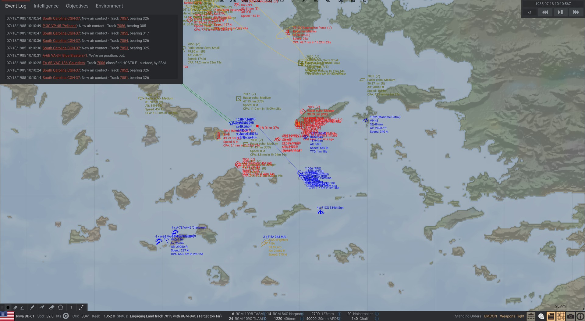

# Sea Power: R.A.T.S. Radio

Radio voices for [Sea Power: Naval Combat in the Missile Age](https://store.steampowered.com/app/1286220/): every unit of
yours talks in its own voice and callsign, and says why it is not doing what you ordered.

| | |
| --- | --- |
| Version | `1.6.0` (2026-11-20) |
| Game | Sea Power 0.9.3 (public and beta) tested in the game; 0.8.7 flat map build checked offline |
| Needs | a mod loader: [R.A.T.S. Keel](https://steamcommunity.com/sharedfiles/filedetails/?id=3835527459) or [Anchor Chain](https://steamcommunity.com/sharedfiles/filedetails/?id=3380210757), either one |
| Get it | [Steam Workshop](https://steamcommunity.com/sharedfiles/filedetails/?id=3826433579) (about 910 MB) |
| Settings | Options > Audio > Rats Radio, or `BepInEx\config\dev.sewerlabs.seapowerradio.cfg` |
| Feedback | [R.A.T.S. feedback board](https://hub.sewerlabs.dev/s/radio) |
| Video | [YouTube, 1:49](https://youtu.be/pGwOIPXckpY) |
| Source | R.A.T.S. Source License, see `LICENSE` |



## Features

- 43 voices in eight English accents, each unit gets its own the moment it exists; accents follow the nation (1.4.0).
- Ships and shore units say their in-game name, aircraft their squadron callsign, others a NATO callsign ([details](docs/features.md)).
- The game's voice lines are muted and spoken by the unit that said them; other mods' lines play as before.
- Moods (1.5.0): stressed, happy and sad takes for warnings, kills and failures ([docs/moods.md](docs/moods.md)).
- Random voices each mission, female voices and gender per squadron (`squadrons.txt`) are switchable.
- A radio net: urgent calls cut in, orders are answered first, stale calls are dropped, up to 3 voices overlap.
- Why-not: the reasons the game never says (out of envelope, no lock, reloading, no line of sight and more).
- Contact calls without spam, joker and bingo fuel calls, landing check, search and rescue.
- Messages link to the unit or track on the map; returning aircraft turn yellow; role lines in the formation manager.
- Order queue window (F8): each stacked attack order with its own delete button.
- Voice packs per country (Options > Audio > Rats Radio > Voice packs): [docs/voice-packs.md](docs/voice-packs.md).

Full detail: [docs/features.md](docs/features.md).

## Install

1. Install a mod loader, either one: [R.A.T.S. Keel](https://steamcommunity.com/sharedfiles/filedetails/?id=3835527459)
   (subscribe, switch it on in the Mods menu, run its setup once) or
   [Anchor Chain](https://steamcommunity.com/sharedfiles/filedetails/?id=3380210757) with its
   [installation guide](https://seapower-modders.github.io/AnchorChain/install-anchor-chain.html).
2. Subscribe to [Sea Power: R.A.T.S. Radio](https://steamcommunity.com/sharedfiles/filedetails/?id=3826433579) on the Workshop.
3. Start a mission. `<Sea Power>\BepInEx\LogOutput.log` lists the voice packs and the roster (unit, callsign, voice, nation).

Manual install: unzip the release into `<Sea Power>\Sea Power_Data\StreamingAssets\SeaPowerRadio\`.

## Settings

| Setting | Default | What |
| --- | --- | --- |
| Female voices | off | units use female voices too |
| Random voices | on | a fresh mission start shuffles the voices |
| Moods | on | stressed, happy and sad takes |
| Overlapping voices | on | a new call may start while the last one plays |
| Radio volume, radio static | 100 % | overall level; static 0 to 150 % |
| Call volumes | per kind | contacts, combat, warnings, replies, other |
| Voice packs | Auto | per country: pack, game voice or Auto |

- All settings: `<Sea Power>\BepInEx\config\dev.sewerlabs.seapowerradio.cfg`; ship names in `aliases.txt`, squadron gender in `squadrons.txt` (formats in [docs/features.md](docs/features.md)).
- Quick fix for "contact faded" spam without any mod: Options > Audio > Report Faded Contacts > off.

## Building

- Needs the .NET SDK (8+), a Sea Power install and the [SeaPowerKeel](https://github.com/struckl/SeaPowerKeel) repo next to this one.
- Two game versions, two builds: `-p:GameBuild=Flat` builds the 0.8.7 flat map DLL.

```bash
dotnet build src/SeaPowerRadio/SeaPowerRadio.csproj -c Release -p:GameDir="C:\Program Files (x86)\Steam\steamapps\common\Sea Power"
```

Details, voice pipeline and continuing on another PC: [docs/building.md](docs/building.md). Releases:
[docs/workshop.md](docs/workshop.md); tests: [docs/testing.md](docs/testing.md); game internals: [docs/how-it-works.md](docs/how-it-works.md).

## Credits and license

- Code and voices: [R.A.T.S. Source License](LICENSE); read it, fork it, send fixes; no re-uploads, no reuse in other projects. Releases before 2026-11-18 stay MIT (code) and CC BY 4.0 (voices).
- Voices are pre-rendered with [Chatterbox](https://github.com/resemble-ai/chatterbox) (MIT) from speakers of the CSTR VCTK Corpus, licensed [CC BY 4.0](https://creativecommons.org/licenses/by/4.0/); credits in [VOICES-LICENSE.md](VOICES-LICENSE.md).
- Corpus: Yamagishi, Veaux, MacDonald (2019). *CSTR VCTK Corpus (version 0.92)*, University of Edinburgh, https://doi.org/10.7488/ds/2645.
- Radio chain from [Ratten Chatter](https://github.com/struckl/RattenChatter); word alignment with wav2vec2-base-960h (Apache-2.0).
- Built on [BepInEx](https://github.com/BepInEx/BepInEx), [HarmonyX](https://github.com/BepInEx/HarmonyX) and [Anchor Chain](https://github.com/SeaPower-Modders/AnchorChain).
- Works with [R.A.T.S. Topo](https://github.com/struckl/SeaPowerTopo) and [R.A.T.S. Pop-Out](https://github.com/struckl/SeaPowerPopOut). No game files are changed.
- Not affiliated with Triassic Games or MicroProse.
