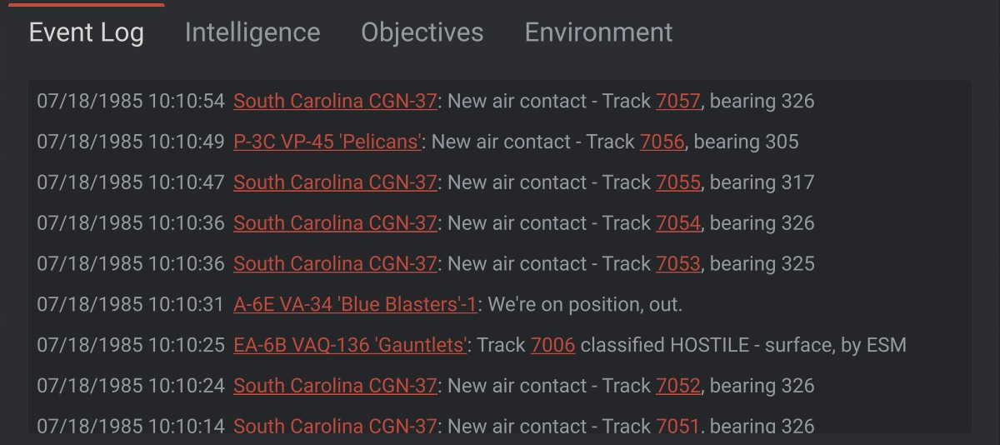
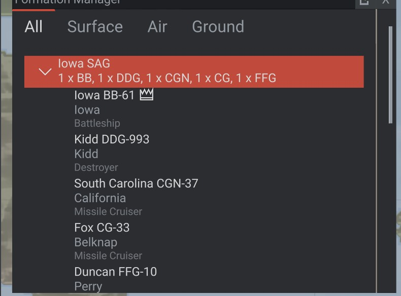

# Sea Power: R.A.T.S. Radio

**Bugs, ideas, questions:** [R.A.T.S. feedback board](https://hub.sewerlabs.dev/s/radio)

> **Sea Power 0.9.3 (16 November 2026):** 1.5.2 was run in the game on 0.9.3, public and beta, on 18 November 2026. It shows as "R.A.T.S. Radio" in the game and declares 0.8.7 up to every 0.9.x in its `_info.ini`.

A mod for [Sea Power: Naval Combat in the Missile Age](https://store.steampowered.com/app/1286220/) that makes the
radio net sound like people instead of a screen reader.

> **2.0: Radio is the radio itself.** The voices are Workshop items of their own (**R.A.T.S. Radio English** today,
> more languages and accents to come), and the reports and tools that came with Radio (why-not, contact, fuel and
> search-and-rescue reports, order queue, clickable messages, unit roles, RTB highlight) are **R.A.T.S. Command Tools**,
> which also works without Radio. Radio lists both as Required Items and speaks Command Tools' reports. Players who had
> Radio before see a short note in the main menu once, with buttons to subscribe what is missing. Other mods can talk
> over the radio too: [docs/rats-bus.md](docs/rats-bus.md).

**[Get it on the Steam Workshop](https://steamcommunity.com/sharedfiles/filedetails/?id=3826433579)** - needs a mod loader, either one: [R.A.T.S. Keel](https://steamcommunity.com/sharedfiles/filedetails/?id=3835527459) or [Anchor Chain](https://steamcommunity.com/sharedfiles/filedetails/?id=3380210757).

**[Watch and listen on YouTube](https://youtu.be/pGwOIPXckpY)** (1:49, sound on) - the same call before and after
1.0.1, then the radio net while Yak-38s close in on the Iowa group. The 1.0.0 video: https://youtu.be/g7P1pg2J0Lk.


## What it does

### Voices

- 43 voices: American, Canadian, English, Scottish, Irish, Northern Irish, Australian and New Zealand accents, men and
  women. Every player unit, and every aircraft a carrier or airbase can launch, gets its own voice the moment it exists.
- Ships and shore units say their in-game short name ("Iowa", "Pargo"), aircraft their squadron callsign from the game
  ("Lancer 3-2"), everyone else a generated NATO callsign ("Viper two-one", "Sentinel").
- Every clip is cut from a whole spoken sentence, so callsign, phrase, bearing, track number, altitude and count join
  like one person talking: no pause before a number ("bearing two seven three") unless the sentence has one
  ("track 7034, faded").
- The game's voice lines are muted and spoken again by the unit that said them. Voice lines of other mods play as before.
  - Speed and altitude orders say which way they go and where to: "coming up to two thirds", "descending, angels
    five". A speed set in knots too.
  - Launch calls name the weapon that is leaving: "harpoon away", "anti-ship away", "missile away", "torpedo away".
- Accents follow the nation (1.4.0): the US and Canada speak with American and Canadian voices, the UK with English,
  Scottish and Northern Irish ones, Australia with Australian, New Zealand with New Zealand then Australian.
  - Units get unused voices of their nation's accents first and share inside them when those run out.
  - A ship's name is rendered in voices of its own nation's accents. Until those clips are rendered, the ship says its
    generated callsign.
  - The list is data in the pack (`accents.txt`). Countries not listed use the whole pack. Pins in `aliases.txt` and
    remembered campaign voices win.
- Random voices each mission (on by default, 1.4.0): a fresh start of a mission shuffles the voices. Callsigns stay.
  - Loading a save keeps the voices of that mission's latest start (`BepInEx/config/SeaPowerRadio/voice-salts.txt`).
  - Linear campaigns keep their remembered voices; dynamic campaigns are not shuffled.
  - Off: a mission always has the same voices.
- Female voices are off by default since 1.4.0. Switched on, units use them too. Off, a unit whose name was rendered
  only in a female voice keeps it.
- Voice gender per squadron, in a text file (no menu entry): `BepInEx/config/SeaPowerRadio/squadrons.txt`, lines like
  `Bear Aces = female` or `Viper = male` (squadron name or callsign). It wins over the Female voices setting.
  Details: [docs/squadron-voices.md](docs/squadron-voices.md).
- Moods (1.5.0): every voice also has stressed, happy and sad takes.
  - Stressed: warnings and weapons calls, and the unit for a minute after its own warning (missile inbound, we're hit,
    flooding).
  - Pleased: a kill, a hit, a rescue, mission success, and the unit's next acknowledgements.
  - Low: a failure, survivors in the water, Winchester, a lost contact.
  - A line the mood has no take for is spoken calmly. The takes live in the voice pack
    (`<persona>/<mood>/<key>.mp3`): [docs/moods.md](docs/moods.md).

### The net

- A unit says its name only when it takes over the net from someone else. The same unit again just goes on, and a
  wingman of the same flight gives its number only ("two, fox three").
- Urgent calls (missile inbound, we're hit, bingo) cut in.
- Replies to your orders go before routine reports and are mixed louder and cleaner.
- Stale calls are dropped: a late "copy" is worse than none.
- The same phrase from a whole flight is said at most twice.
- Radio sound per transmission: carrier hiss, mic click, crackle, squelch tail. It plays through the game's voice
  channel, so the game's voice volume slider applies.
- Overlapping voices (on by default): a new call starts about a second after the last one began, while that one is
  still playing. Up to 3 at once, panned a little left and right, never the same unit twice. Off: one voice at a time.
- The message of a call stays bottom right until it has been spoken, with a thin marker on the one being spoken.

### With other mods

- Reports from R.A.T.S. Command Tools are spoken (2.0): why-not reasons, contact reports without the spam, joker /
  bingo / fuel emergency, search and rescue. Command Tools finds them and raises the messages, Radio says them in the
  unit's voice.
  - Without Command Tools those reports are not there, and the game's own contact lines play as in the unmodded game.
  - Command Tools also brings the order queue window (F8), clickable units and tracks in messages, unit roles in the
    formation manager and the RTB highlight. Before 2.0 all of this was part of Radio.
- Other mods on the net (2.0): a mod can ask Radio to speak a line for a unit, and can bring its own lines as a line
  pack (`linepack.ini`, clips per voice, no code): [docs/rats-bus.md](docs/rats-bus.md).

### Settings and voice packs

- Options > Audio has a group **Rats Radio**: female voices, random voices, overlapping voices, moods, radio volume,
  radio static (0 = clean voice, 100 % = the default amount) and a volume for each kind of call (contact and track
  calls, combat calls, warning calls, replies to orders, other calls). Changes apply at once and are saved.
- Every feature has its own entry in the config file.
- The 43 voices are the **NATO (English)** pack, since 2.0 the item **R.A.T.S. Radio English**. Other languages and
  accent packs come as separate Workshop items too (no DLL needed).
- Options > Audio > Rats Radio > **Voice packs** lists every country (NATO, Warsaw Pact, Other) with a drop-down:
  *Auto* (the installed pack for that country, else the game's voice), *Game voice* or a pack.
  - A country without a pack keeps the game's own voice: the Soviets speak the game's Russian. Choose *NATO (English)*
    for that country to get the English radio net.
  - A line a pack lacks is also left to the game.
  - Applies from the next mission. Pack format: [docs/voice-packs.md](docs/voice-packs.md).

| | |
| --- | --- |
|  |  |

Voices are pre-rendered: 43 distinct voices (based on speakers of the VCTK corpus, rendered with Chatterbox) put
through the radio chain from [Ratten Chatter](https://github.com/struckl/RattenChatter). Nothing is rendered at runtime;
everything works offline.

## Installation

1. Install a mod loader, either one: **[R.A.T.S. Keel](https://steamcommunity.com/sharedfiles/filedetails/?id=3835527459)** (subscribe, switch it on in the Mods menu, copy its one stub
   file once; it is the one that runs on the 3D-globe public beta) or **[Anchor Chain](https://steamcommunity.com/sharedfiles/filedetails/?id=3380210757)** following its
   [installation guide](https://seapower-modders.github.io/AnchorChain/install-anchor-chain.html) (one manual step: copy its
   preloader into the game folder).
2. Subscribe to **[Sea Power: R.A.T.S. Radio](https://steamcommunity.com/sharedfiles/filedetails/?id=3826433579)** on the Steam Workshop. Steam offers its
   Required Items with it: **R.A.T.S. Radio English** (the 43 voices with their moods, about 910 MB) and **R.A.T.S. Command Tools**. The
   game's Mod menu fetches missing ones too ("Sync dependencies").
3. Start a mission. The log `<Sea Power>\BepInEx\LogOutput.log` lists the installed voice packs and the roster: every
   unit with its callsign, voice (`packId/personaId`) and nation.

Manual install instead of the Workshop: unzip the release into `<Sea Power>\Sea Power_Data\StreamingAssets\
SeaPowerRadio\` (`SeaPowerRadio.dll`, `SeaPowerRadioFlat.dll`, `_info.ini`, `data\`), the English pack into its own folder
(`StreamingAssets\SeaPowerRadioEnglish\`), and Command Tools as its own release says.

Settings: in the game, Options > Audio > **Rats Radio** (see above). The same values are in
`<Sea Power>\BepInEx\config\dev.sewerlabs.seapowerradio.cfg` (volumes, static, voices, how many voices may overlap, ...).
The reports and tools have their own file since 2.0 (`dev.sewerlabs.seapowercommandtools.cfg`), which takes over your
earlier Radio settings for them once.

**Mod ships and their names.** A ship says its name only if that name was rendered as a clip (every ship and shore unit
of the base game, `voices/names.txt`); any other name gets a generated callsign. Hull prefixes such as USS, HMS, HMCS or
FGS are stripped automatically, so a modded "USS Pargo" says "Pargo". For everything else there is
`<Sea Power>\BepInEx\config\SeaPowerRadio\aliases.txt` (created at the first mission, Workshop updates never touch it):

```
USS Pargo = Pargo                  # say the name of a base-game ship
HMS Bristol = Bristol | gb_m_06    # and pin it to one voice
HMS Bristol = | gb_m_06            # only pin the voice
CVN-68* = Nimitz                   # '*': every name that starts with it
Akira O-ren = Victory              # or keep a callsign word for good
*prefix HNoMS, HSwMS               # more prefixes to strip
```

It can only point to names that have clips: a base-game ship name, or one of the ship, submarine and shore callsign
words (Bulwark, Sentinel, Victory, Warden, Guardian, Valiant, Resolute, Steadfast, Vigilant, Defiant, Intrepid, Courage,
Shadow, Silent, Deepwater, Barracuda, Castle, Bastion, Harbor, Lighthouse). A word given this way is that ship's alone. A
truly new name needs new clips. Edits apply from the next mission, and the
log says when a line names a ship or voice that does not exist. A ship mod can ship its own `rats-radio-aliases.txt` in
its folder. Details: [docs/name-aliases.md](docs/name-aliases.md).

Interim fix for "contact faded" spam without any mod: Options > Audio > **Report Faded Contacts** > off.

## Compatibility

- Sea Power 0.8.7 up to 0.9.x (declared in `_info.ini`). Every game hook is resolved at startup; one the game has moved or renamed switches off only the
  feature that needs it (the log says which) - the rest keeps working.
- Works together with the other Sea Power mods by the same author:
  [Topographic Map](https://github.com/struckl/SeaPowerTopo) and
  [Pop-Out Windows](https://github.com/struckl/SeaPowerPopOut).
- No game files are changed.

## Feedback and bug reports

Bugs, feedback and ideas go on the R.A.T.S. feedback board: <https://hub.sewerlabs.dev/s/radio>.
For a bug, add `<Sea Power>\BepInEx\LogOutput.log` as a link; it lists the roster, every call and every refusal.

## Building

Requires the .NET SDK (8+), a local Sea Power install and the [SeaPowerKeel](https://github.com/struckl/SeaPowerKeel)
repo next to this one: the game's assemblies and Keel's copy of Anchor Chain's library are referenced directly
(`-p:AnchorChainDir=...` points at another copy).

```bash
dotnet build src/SeaPowerRadio/SeaPowerRadio.csproj -c Release -p:GameDir="C:\Program Files (x86)\Steam\steamapps\common\Sea Power"
```

A successful build copies the DLL and `mod/` (voice library, `_info.ini`) into
`<GameDir>/Sea Power_Data/StreamingAssets/SeaPowerRadio/`. `GameDir` can also be set as an environment variable.
Pass `-p:Deploy=false` to build without touching the game folder - and do, while the game is running (it locks the
DLLs).

**Two game versions, two builds.** Sea Power exists in two versions with different map code: 0.8.7's flat map and the
3D-globe build (0.9.x), and a mod compiled against one fails on the other (the map-symbol
hook, the night-colour switch and a field the game turned into a property differ). So the same sources are built twice:
the default build is for the globe game (`SeaPowerRadio.dll`), `-p:GameBuild=Flat` compiles against a copy of 0.8.7's
`Sea Power_Data\Managed` (`-p:FlatManagedDir=...`, default `..\_gamerefs\SeaPower-0.8.7-public\Managed` next to the mod
folders in the workspace) into `SeaPowerRadioFlat.dll`. The package holds both; each looks at the game it runs on and
stays off when it is not the one it was made for (the log says which runs). Anchor Chain skips a plugin whose GUID it
has already seen, so the flat build registers as `dev.sewerlabs.seapowerradio.flatmap`. The start, the hook registry, the
config file, the log and the host object are the workspace's shared skeleton (`SeaPowerKeel\shared`, compiled into the DLL
as linked source; the csproj imports its `Rats.Mod.props`). `tools/package.ps1` builds and checks both
(`tools/compat-check` in the workspace).

Releases: [docs/workshop.md](docs/workshop.md) (`tools/package.ps1`); in-game test checklists:
[docs/testing.md](docs/testing.md); the game systems the mod hooks into (stock voices, why a unit doesn't fire,
mission lifecycle, contacts) and how to decompile the game: [docs/how-it-works.md](docs/how-it-works.md); the stock
voice lines and where the game raises them: [docs/stock-voice-events.md](docs/stock-voice-events.md).
Voice packs (format, discovery, per-country choice): [docs/voice-packs.md](docs/voice-packs.md); the languages planned
for them (Russian, Spanish, ...): [docs/languages-roadmap.md](docs/languages-roadmap.md). `tools/package.ps1 -Pack <id>`
stages a pack folder for upload.

The rendered voice library (`mod/voices/<persona>/`, ~57,000 mp3 clips) is not in git: it comes with every release
and can be rebuilt with the voice pipeline below.

**Continuing on another PC** (a fresh clone has only the text files in `mod/voices/`, so `tools/package.ps1` stops with
"Rendered voices missing" and `check_library.py` lists everything): download the zip of the latest
[GitHub release](https://github.com/struckl/SeaPowerRadio/releases) and copy its `SeaPowerRadio\voices\*` into
`mod\voices\`; build the reference clips (`tools/voicegen/refs/`, also not in git) with `vctk_refs.py` as below; then
`check_library.py` shows what is really missing and `chatterbox_render.py` resumes with just those takes. Don't start a
full render without the library: it redoes everything.

## Voice pipeline

`tools/voicegen/` (Python + ffmpeg). Shipped voices: [Chatterbox](https://github.com/resemble-ai/chatterbox) on a
local GPU, each persona rendered from one speaker of the [CSTR VCTK Corpus](https://doi.org/10.7488/ds/2645).
edge-tts (`generate.py`) remains as a fallback engine.

| File | What it is |
| --- | --- |
| `cast.py` | the 43 NATO/English personas, one VCTK speaker each (US, Canada, England, Scotland, Ireland, Northern Ireland, Australia, New Zealand; 30 m / 13 f); writes `mod/voices/personas.txt` |
| `vctk_refs.py` | builds a ~12 s reference clip per persona from VCTK, reading single parquet row groups from Hugging Face instead of the 17.6 GB corpus (`vctk/index.json`, `vctk/speaker-info.txt`) |
| `phrases.py` | phrase catalog (stock keys, why-not reasons, callouts, T3 identification causes) as *takes*: every clip is cut out of a whole sentence (phrases after a carrier callsign, callsign words / flight-position pairs / number pieces each in the slot they're used in), so stitched pieces keep the voice's own melody and pauses. `{trk}`/`{brg}`/`{num}`/`{alt}`/`{count}` slots split a phrase around a number. `STOCK_MAP` maps every stock voice key to its replacement |
| `chatterbox_render.py` | renders the library into `mod/voices/<persona>/` on the GPU; phrase urgency -> `exaggeration`/`cfg_weight`; hallucinated or unalignable takes are re-rolled; resumable |
| `align.py` | CTC forced aligner (wav2vec2) giving word timestamps, since Chatterbox reports none |
| `radio.py` | the radio sound, split into the *voice* half (baked per clip) and the *transmission* half (hiss, click, crackle, squelch, loudness gain and soft limiter - once per transmission, at runtime); its `transmission()` follows the plugin's RadioFx step for step |
| `reel.py` | stitches clips into transmissions like the plugin will, pauses at numbers closed up the same way -> `tools/voicegen/samples/` (`--as-cut`: joins as cut, for comparison; `--library`: another checkout's voices) |
| `names.py` | in-game names: ship/shore short names and squadron callsign words from the game's language files, each bound to a few voices -> `mod/voices/names.txt` |
| `rules.py` | the one source of the rules plugin and tools share: callsign words, clip number ranges, pauses at numbers, phrase groups (call volumes, moods), priority thresholds, the radio sound table |
| `rules_cs.py` | writes `rules.py`, the named variants and a few phrase facts into `src/SeaPowerRadio/Radio/ClipRules.g.cs` |
| `check_sync.py` | checks that `ClipRules.g.cs`, `catalog.txt` and `stockmap.txt` are current, that every phrase group and named variant exists, and that every stock key is mapped - run before a build and a render |
| `check_library.py` | lists takes still missing from the rendered library |
| `full_render.ps1` | detached, game-aware full render (pauses while a game runs), verify, re-roll, deploy |
| `generate.py`, `edge_cast.py` | edge-tts fallback engine and its cast |

```bash
# Chatterbox venv (torch + CUDA, ~5 GB) -- separate from the light .venv used for reels
python -m venv .venv-chatterbox
.venv-chatterbox/Scripts/python -m pip install "torch>=2.9" "torchaudio>=2.9" --index-url https://download.pytorch.org/whl/cu128
.venv-chatterbox/Scripts/python -m pip install chatterbox-tts==0.1.7 pyarrow
.venv-chatterbox/Scripts/python tools/voicegen/vctk_refs.py                      # reference clips
.venv-chatterbox/Scripts/python tools/voicegen/chatterbox_render.py --voices all  # ~26k takes, many hours
# or detached and game-aware (stops while Hunt / Sea Power / Nuclear Option / CS2 run and frees the VRAM, resumes
# 2 min after the game closes), then checks the library, re-rolls takes that gave up, deploys the mod into the game
# and with -ShutdownWhenDone powers the PC off (abort: shutdown /a). Log: tools/voicegen/out/full_render.log.
powershell -NoProfile -ExecutionPolicy Bypass -File tools/voicegen/full_render.ps1 -ShutdownWhenDone
.venv-chatterbox/Scripts/python tools/voicegen/check_library.py                  # what's still missing

python -m venv .venv && .venv/Scripts/python -m pip install -r tools/voicegen/requirements.txt
.venv/Scripts/python tools/voicegen/reel.py --voices us_m_01,sc_m_04,us_f_01     # listening sample
```

## Layout

```
src/SeaPowerRadio/        C# plugin (netstandard2.1, BepInEx 5 / HarmonyX via Anchor Chain)
  Plugin.cs, ModInfo.cs   Anchor Chain entry point; what the shared skeleton reads (GUID, name, version, log source)
  RadioApi.cs, RatsBus.cs what other mods call: rats.radio.say and line packs (docs/rats-bus.md)
  Hooks.cs                every game hook, grouped by feature (shared HookRegistry); a missing target disables only that
                          feature, except the mission and launch hooks the roster needs (then the mod stays off)
  RadioHost.cs, Settings.cs  the host object (shared ModHost) and the config entries (shared ModSettings)
  Core/EventBus.cs        the aircraft-launched event (mission start/end come from the shared MissionHooks)
  Patches/                Harmony patches (stock voice capture, launching weapon, speed orders, aircraft launch, alerts, options)
  Roster/                 player elements + hangar slots → callsign + voice
  Voices/                 callsign generator, voice assignment, voice library loader
  Radio/                  Catalog (catalog.txt / stockmap.txt), TransmissionBuilder (callsign + phrase + number
                          pieces, how much pause each join keeps), ClipLibrary (on-demand loading, LRU), RadioFx
                          (joins the clips, hiss, click, crackle, squelch),
                          RadioPlayer (priority queue, up to 4 channels for overlapping voices), CallCategory (call kind → volume),
                          StockVoiceRouter (stock line → own voice)
  Ui/                     OptionsPage: the "Rats Radio" group in the Options menu's Audio tab (code-built Noesis controls)
mod/                      files shipped next to the DLL (voices/: personas.txt, catalog.txt, stockmap.txt,
                          names.txt, rendered clips; _info.ini; rats-radio-aliases.txt = default hull prefixes)
tools/voicegen/           offline voice pipeline (cast.py = the persona list; rules.py = the clip and sound rules the
                          plugin shares, written to Radio/ClipRules.g.cs by rules_cs.py; check_sync.py checks both sides)
tools/package.ps1         release build → dist/SeaPowerRadio/ (+ release zip)
tools/shot-director/      dev-only plugin that drives the game for the Workshop screenshots (never shipped)
docs/                     test checklists, stock voice inventory, Workshop release
```

## Licenses and credits

- **Code and voices**: [R.A.T.S. Source License](LICENSE): read it, fork it, send fixes; no re-uploads, no reuse in other projects.
- **Voice credits**: [VOICES-LICENSE.md](VOICES-LICENSE.md) (the VCTK Corpus they come from is CC BY 4.0).
- Releases before 2026-11-18 stay MIT (code) and CC BY 4.0 (voices).

Built on [BepInEx](https://github.com/BepInEx/BepInEx), [HarmonyX](https://github.com/BepInEx/HarmonyX) and
[Anchor Chain](https://github.com/SeaPower-Modders/AnchorChain). Radio chain from
[Ratten Chatter](https://github.com/struckl/RattenChatter).

Voices rendered with [Chatterbox](https://github.com/resemble-ai/chatterbox) (MIT license) from speakers of the
**CSTR VCTK Corpus**:
Yamagishi, Junichi; Veaux, Christophe; MacDonald, Kirsten (2019). *CSTR VCTK Corpus: English Multi-speaker Corpus
for CSTR Voice Cloning Toolkit (version 0.92)*. University of Edinburgh, The Centre for Speech Technology Research.
https://doi.org/10.7488/ds/2645 - licensed under [CC BY 4.0](https://creativecommons.org/licenses/by/4.0/).
Word alignment uses [wav2vec2-base-960h](https://huggingface.co/facebook/wav2vec2-base-960h) (Apache-2.0).

Not affiliated with Triassic Games or MicroProse. Nothing of the game is included in this repository or the mod.
